# Cuestiones UT3 – NovaHarvest

### 1. De .cshtml a HTML

Cuando ejecuto `dotnet build`, Razor convierte los archivos `.cshtml` en código C# y los compila junto al resto del proyecto. Cuando alguien entra en `/surplus`, se ejecuta el código de esa página y se genera el HTML que recibe el navegador. Al buscar la clase generada de `Status.cshtml`, he encontrado `Pages_Status` en `Status_cshtml.g.cs`. Un ejemplo de `WriteLiteral` es `WriteLiteral("\r\n<h1>Estado del servidor</h1>\r\n\r\n
Fecha y hora del servidor: ");`, que corresponde al HTML y al texto que he escrito directamente en la página. Un ejemplo de `Write` es `Write(Model.ServerTime.ToString("dd/MM/yyyy HH:mm:ss"));`, que corresponde a la expresión `@Model.ServerTime.ToString("dd/MM/yyyy HH:mm:ss")` y muestra su resultado. En el contenedor no hay archivos `.cshtml` porque las páginas ya están compiladas y no hacen falta los archivos originales para ejecutar la aplicación.

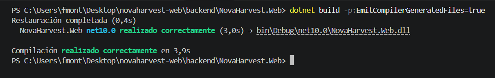

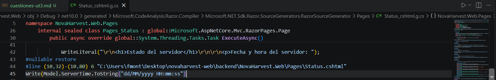

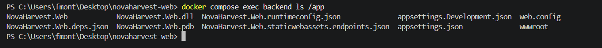

### 2. Tecnologías

En mi página `Surplus.cshtml`, la línea del precio es `
Precio de excedente: @Model.SurplusPrice.ToString("C") / kg
`. En PHP se escribiría `
Precio de excedente: <?= ... ?> / kg
`, utilizando `<?php ... ?>` para insertar código y `<?= ... ?>` para mostrar directamente un valor. En ASP clásico sería `
Precio de excedente: <%= ... %> / kg
`, utilizando `<% ... %>` para insertar código y `<%= ... %>` para mostrar un valor. En cambio, Razor utiliza `@` para indicar dónde empieza el código y deduce dónde termina.

En la UT2 tenía los `MapGet` en `Program.cs` y escribía el HTML dentro de cadenas de texto utilizando `Results.Content()`. Ahora, en la UT3, utilizo `AddRazorPages()` para registrar Razor Pages y `MapRazorPages()` para conectar las páginas con sus rutas. También mantengo `MapStaticAssets()` para los archivos estáticos y uso `UseRequestLocalization("es-ES")` para establecer la cultura española. De esta forma, `Program.cs` es más sencillo y el HTML y el código de cada página están separados en sus archivos `.cshtml`. Además, puedo reutilizar la cabecera, el menú y el pie de página mediante `_Layout.cshtml`, sin tener que repetirlos en todas las páginas.

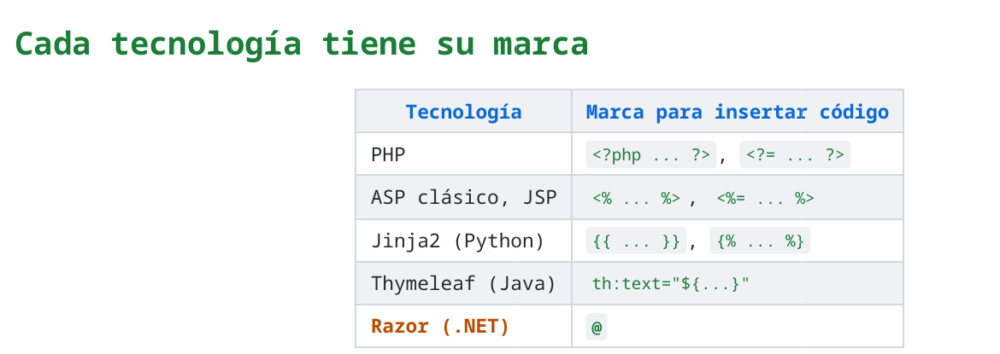

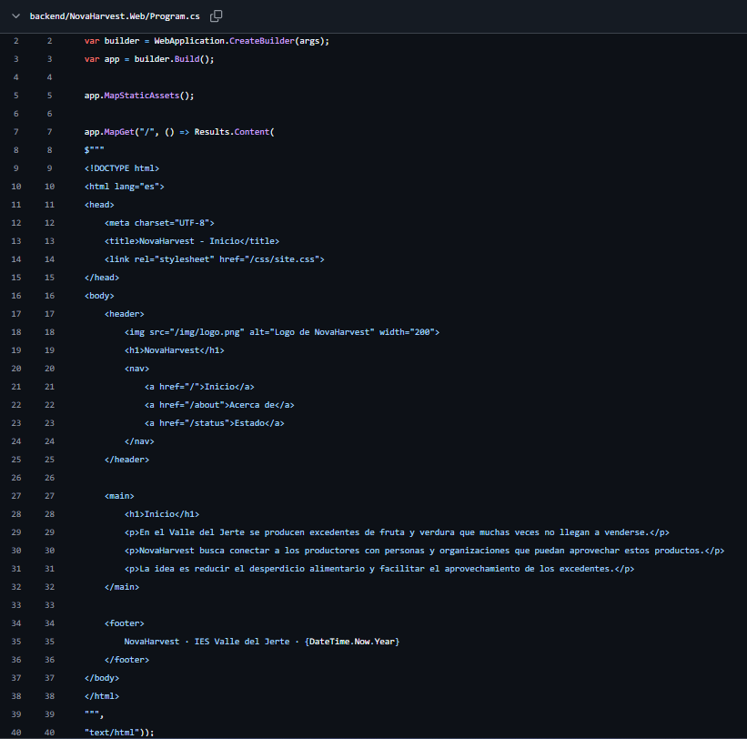

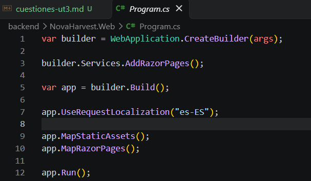

### 3. Etiquetas de código

En mi proyecto tengo varios ejemplos de etiquetas Razor. Una expresión implícita aparece en `Surplus.cshtml` con `@Model.Surplus.Product`, que genera `<h2>Cereza Picota</h2>`. Una expresión explícita aparece en `class="@(Model.Urgent ? "urgent" : null)"`, que añade `class="urgent"` si se cumple la condición y, si no, no genera ese atributo. Un bloque `@{ }` aparece en `About.cshtml` con `ViewData["Title"] = "Acerca de";`, que no genera HTML directamente, pero permite que el layout muestre `<title>Acerca de - NovaHarvest</title>`. También he añadido el comentario `@* Página con información sobre NovaHarvest *@`, que Razor elimina y no aparece en el HTML generado. Por último, en `About.cshtml` utilizo `@@novaharvest`, que se muestra como `@novaharvest`. En cambio, `info@novaharvest.es` solo necesita una arroba porque Razor reconoce que forma parte de una dirección de correo y la deja como texto normal. Sin embargo, para mostrar `@novaharvest` tengo que escribir dos arrobas porque Razor puede interpretar una sola como el inicio de código C#. Al poner dos, consigo que en la página aparezca una sola arroba.

### 4. Sintaxis

En la primera prueba cambié `@Model.SurplusPrice` por `@Model.SurplusPrize` y, al ejecutar `dotnet build`, me apareció el error CS1061 porque `SurplusModel` no tiene ninguna propiedad llamada `SurplusPrize`. La propiedad correcta es `SurplusPrice`, por eso no compila.

En la segunda prueba escribí `@Model.Surplus.PricePerKg * 0.7m`. Esta vez sí compiló, pero en la página apareció `3,20 * 0.7m` sin hacer la multiplicación. Esto ocurre porque Razor interpreta `@Model.Surplus.PricePerKg` como código C# y deja `* 0.7m` como texto normal.

Para corregirlo tengo que poner toda la operación entre paréntesis: `@(Model.Surplus.PricePerKg * 0.7m)`. Así Razor entiende que toda la operación es código y calcula el resultado. Después de hacer las pruebas, dejé el código como estaba originalmente.

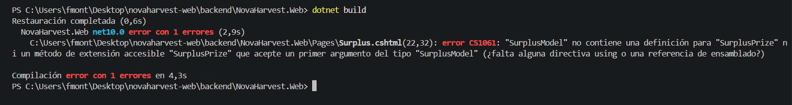

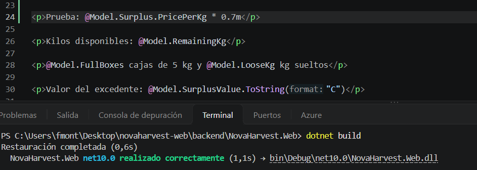

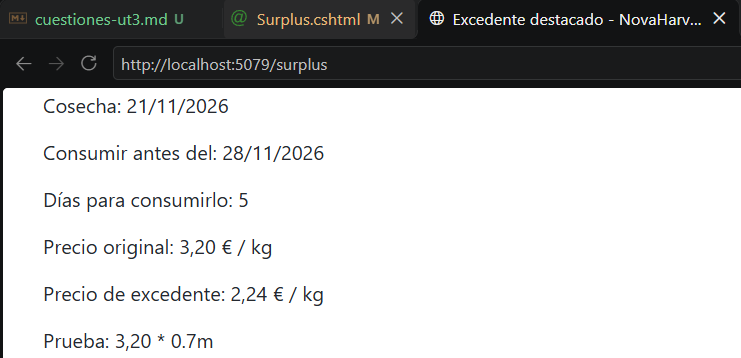

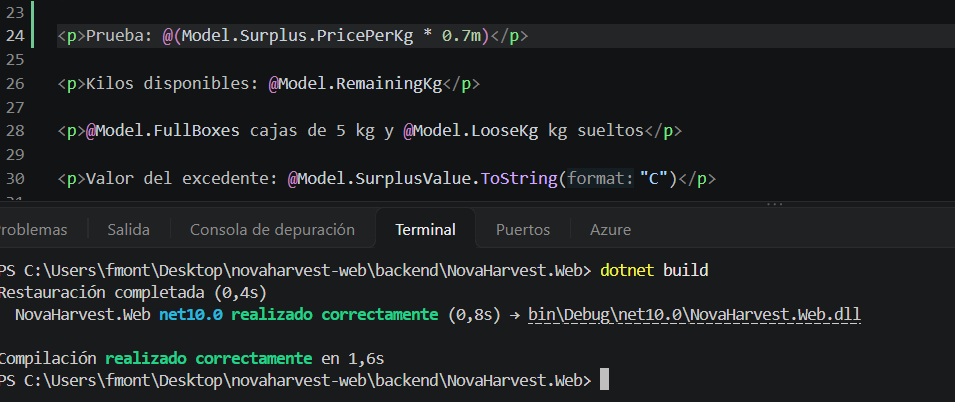

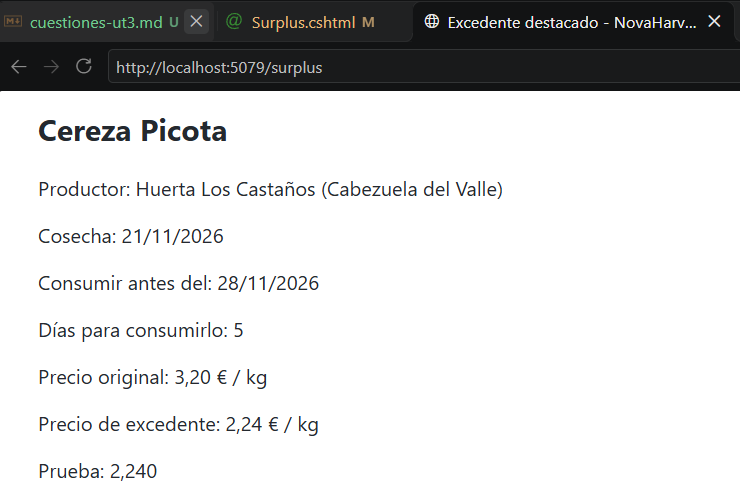

### 5. Efectos en el documento

En mi proyecto, la nota del productor aparece en pantalla con las etiquetas `<b>` visibles, pero sin poner el texto en negrita. En el código fuente aparece como `&lt;b&gt;Recoger antes de las 14:00&lt;/b&gt;`. Esto ocurre porque Razor convierte automáticamente los caracteres especiales para que el navegador los muestre como texto y no los interprete como etiquetas HTML. Lo hace para evitar que el contenido introducido por un usuario se ejecute como código. Si utilizara `@Html.Raw` y un usuario malintencionado introdujera código HTML o JavaScript en la nota, podría ejecutarse en el navegador de otras personas y provocar problemas de seguridad.

En el escenario A, con los valores originales, los elementos aparecen así:

`
Días para consumirlo: 5
`
`<button>Reservar</button>`

No aparece `class` porque el excedente no es urgente y tampoco aparece `disabled` porque quedan kilos disponibles.

En el escenario C, cambié `ReservedKg` a 343 y el resultado fue:

`
Días para consumirlo: 5
`
`<button disabled="disabled">Reservar</button>`

En este caso no aparece `class` porque no es urgente y sí aparece `disabled` porque ya no quedan kilos disponibles.

En el escenario D, cambié la fecha de cosecha a `DateTime.Today.AddDays(-6)` y obtuve:

`
Días para consumirlo: 1
`
`<button>Reservar</button>`

Aquí aparece `class="urgent"` porque queda un día para consumirlo y todavía hay kilos disponibles. El botón sigue habilitado porque quedan kilos disponibles. Después de las pruebas, he vuelto a dejar los valores originales.

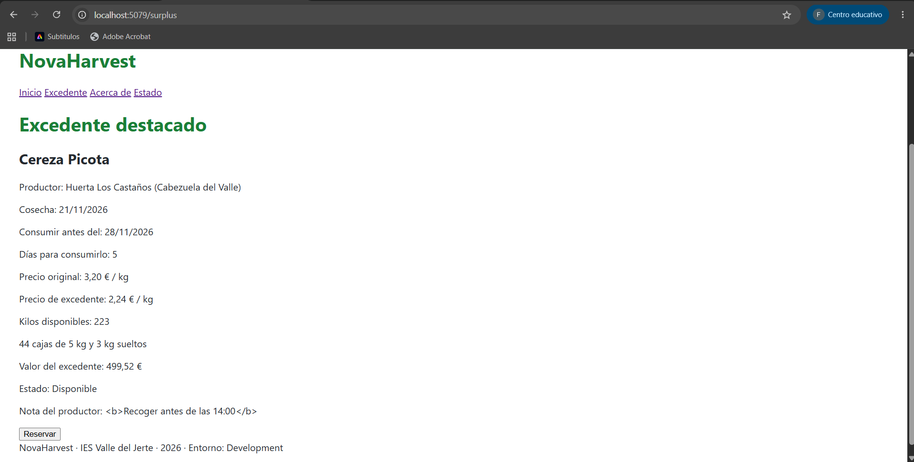

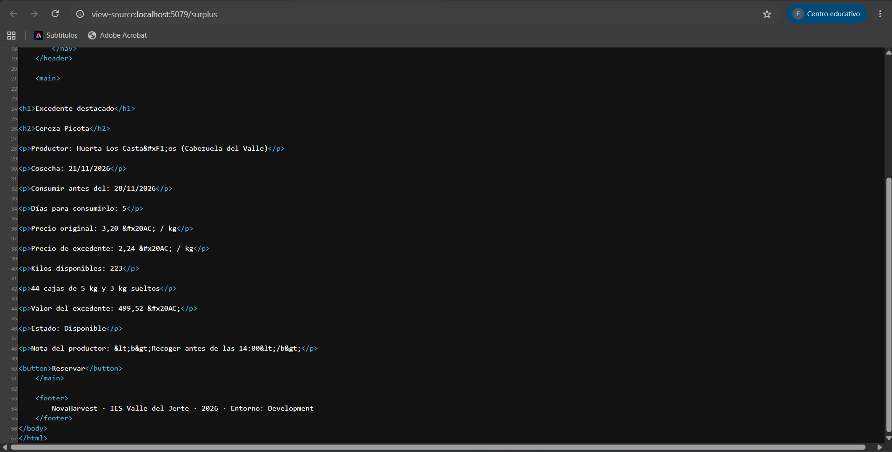

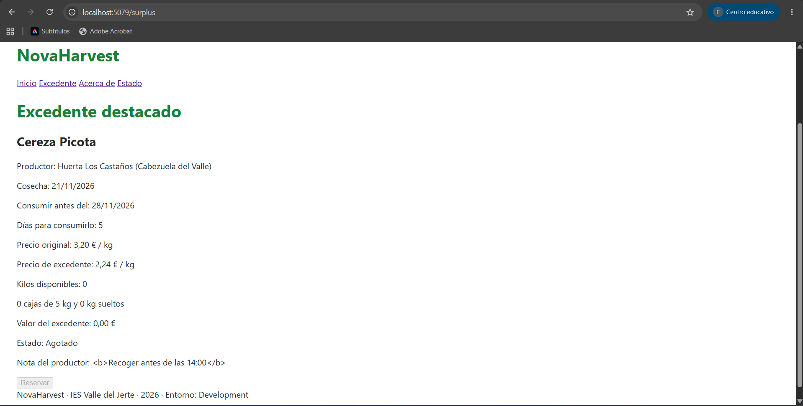

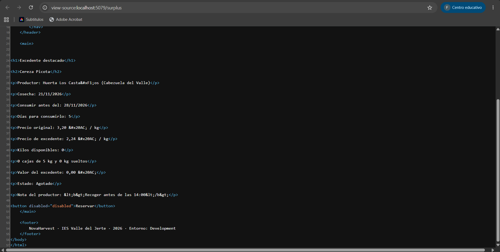

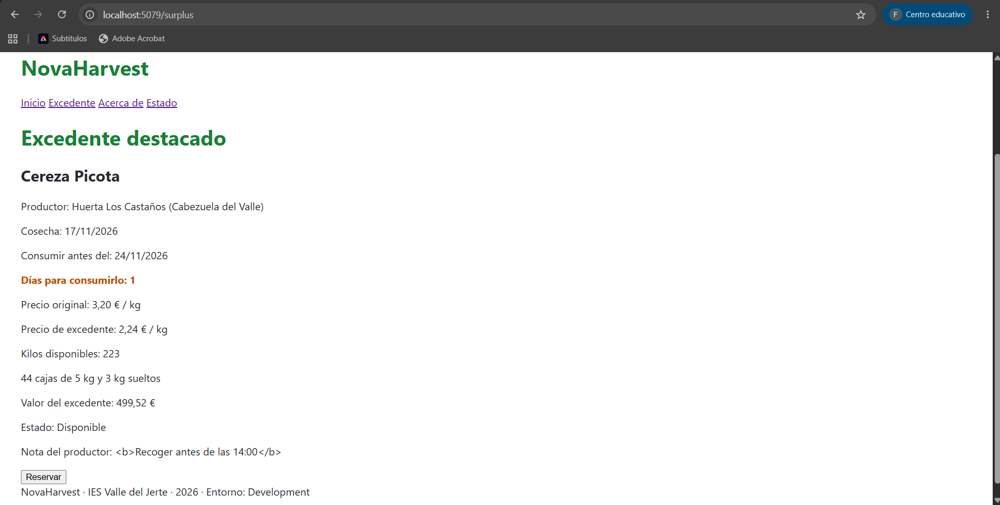

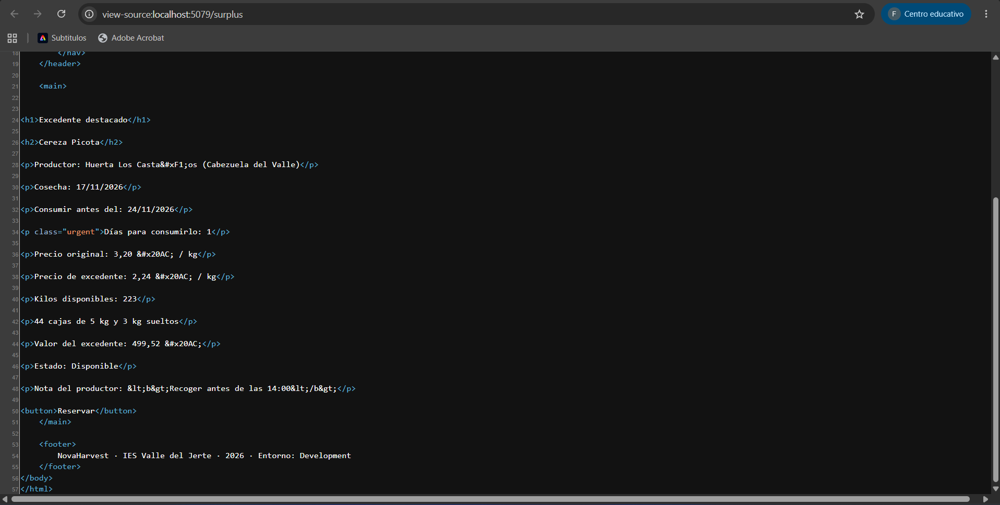

### 6. Directivas

En mi proyecto utilizo varias directivas y archivos especiales de Razor que cambian el comportamiento normal de las páginas:

| Directiva o archivo | Comportamiento por defecto que cambia en mi proyecto |
|---|---|
| `@page` | Hace que `Index.cshtml`, `About.cshtml`, `Status.cshtml` y `Surplus.cshtml` sean páginas Razor a las que puedo acceder mediante sus rutas. |
| `@page "/ticket"` | Establece una ruta concreta para `Ticket.cshtml`. Aunque el archivo está dentro de `Reservations`, puedo acceder a él mediante `/ticket`. |
| `@model` | Indica qué PageModel utiliza cada página para acceder a sus datos mediante `@Model`, por ejemplo `SurplusModel` o `StatusModel`. |
| `@using` | Importa el espacio de nombres `NovaHarvest.Web.Models`, por lo que puedo utilizar sus clases sin tener que escribir el nombre completo. |
| `@namespace` | Establece el espacio de nombres de las clases que Razor genera para las páginas. En mi proyecto permite que se encuentren `SurplusModel` y `StatusModel`. |
| `@inject` | Me permite utilizar servicios de ASP.NET Core directamente en una página. En `_Layout.cshtml` lo utilizo para acceder a `IWebHostEnvironment` mediante `Env`. |
| `_ViewStart.cshtml` | Establece `_Layout.cshtml` como diseño común para las páginas, así no tengo que repetir la misma estructura en cada una. |
| `Layout = null` | Desactiva el uso del layout común. Lo utilizo en `Ticket.cshtml` porque tiene su propio HTML completo. |

Al quitar `@namespace NovaHarvest.Web.Pages` de `_ViewImports.cshtml` y ejecutar `dotnet build`, aparecieron 6 errores CS0246. El compilador no encontraba `SurplusModel` ni `StatusModel` porque las páginas generadas ya no utilizaban el espacio de nombres donde están esas clases. Después volví a poner la línea de `@namespace` y el proyecto volvió a compilar correctamente.

Por último, `/reservations/ticket` devuelve un error 404 porque en `Ticket.cshtml` he indicado la ruta `@page "/ticket"`. Por eso la dirección correcta para acceder al justificante es `/ticket`, aunque el archivo esté dentro de la carpeta `Reservations`.

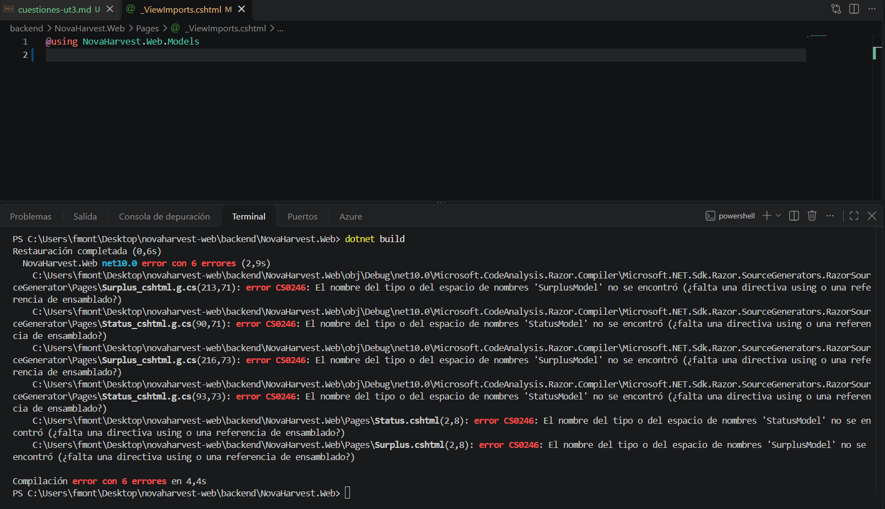

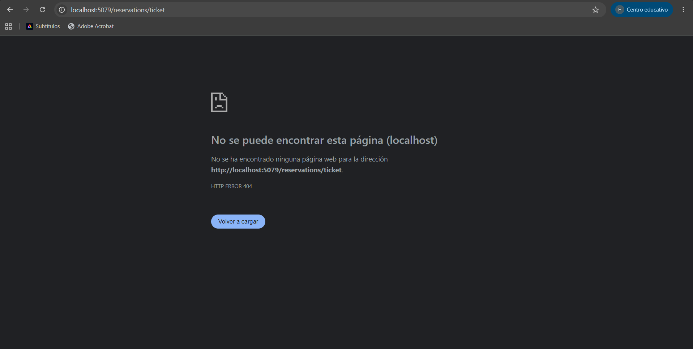

### 7. Tipos y operadores

En mi `SurplusModel` utilizo diferentes tipos de datos según lo que necesito guardar o calcular:

| Dato | Tipo de C# | Operadores o métodos que utilizo | Por qué utilizo ese tipo |
|---|---|---|---|
| `RemainingKg` | `int` | `-` | Son kilos enteros y calculo los que quedan restando los reservados a los disponibles. |
| `ConsumeBefore` | `DateTime` | `AddDays()` | Es una fecha que calculo sumando los días de conservación a la fecha de cosecha. |
| `DaysToConsume` | `int` | `-` y `.Days` | Necesito saber cuántos días quedan hasta la fecha límite. |
| `SurplusPrice` | `decimal` | `-` y `*` | Es un precio y utilizo decimales para calcular el descuento. |
| `FullBoxes` | `int` | `/` | Representa el número de cajas completas. |
| `LooseKg` | `int` | `%` | Representa los kilos que sobran después de llenar las cajas. |
| `SurplusValue` | `decimal` | `*` | Es el valor total del excedente, por lo que puede tener decimales. |
| `HasStock` | `bool` | `>` | Indica si quedan kilos disponibles. |
| `Status` | `string` | `!`, `<` y `?:` | Guarda el texto que corresponde al estado del excedente. |
| `ProducerNote` | `string` | `??` | Guarda la nota del productor o un texto alternativo si no hay ninguna. |
| `Urgent` | `bool` | `<=` y `&&` | Comprueba si quedan dos días o menos y todavía hay kilos disponibles. |

La división `RemainingKg / BoxKg` da cajas completas porque las dos variables son de tipo `int`. Al dividir dos números enteros, C# elimina la parte decimal y se queda con el resultado entero. Los kilos que sobran los calculo utilizando `%`, que devuelve el resto de la división.

También he probado qué ocurre al utilizar `decimal` en la división. Con los mismos 223 kg, al dividir entre `5` como entero obtengo `44`, mientras que utilizando `5m` obtengo `44,6`. Si los kilos fueran de tipo `decimal`, la división también conservaría los decimales y tendría que adaptar el cálculo para obtener las cajas completas.

Al mostrar directamente `@Model.HasStock` en Razor, aparece `True`, porque es un valor booleano. En cambio, al mostrar `null` directamente, no aparece nada en la página, ya que no tiene ningún valor que mostrar.

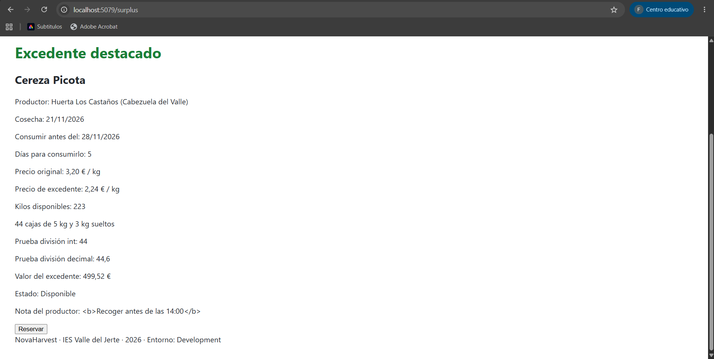

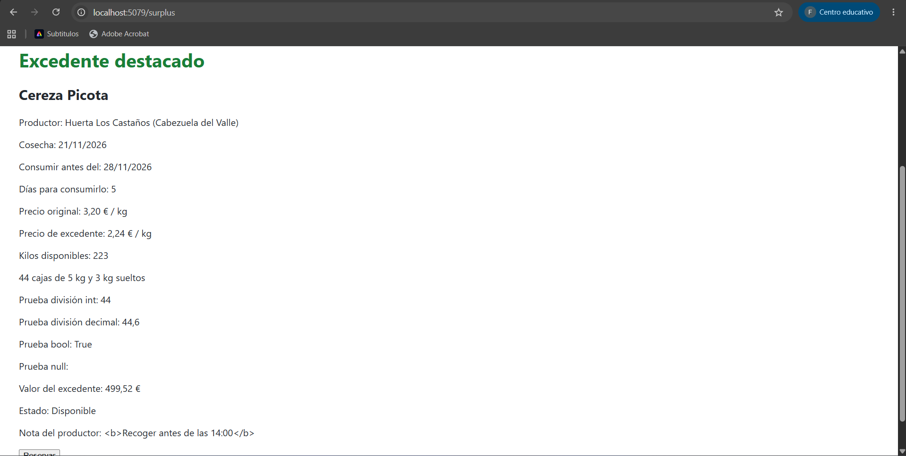

### 8. Cultura

He quitado temporalmente `app.UseRequestLocalization("es-ES")` y he probado NovaHarvest tanto con Docker como con `dotnet run`. Con Docker, el precio original aparece como `¤3.20`, el precio de excedente como `¤2.24` y el valor del excedente como `¤499.52`. Además, la fecha de inicio aparece en inglés: `Monday, 23 November 2026`.

En cambio, con `dotnet run`, el precio original aparece como `3,20 €`, el precio de excedente como `2,24 €` y el valor del excedente como `499,52 €`. La fecha también aparece en español: `lunes, 23 de noviembre de 2026`.

Esto ocurre porque cada entorno utiliza una cultura diferente cuando no indicamos ninguna. Para solucionarlo utilizo `app.UseRequestLocalization("es-ES")` en `Program.cs`, que establece la cultura española para las peticiones. Así consigo que los precios y las fechas tengan el mismo formato en Docker y con `dotnet run`.

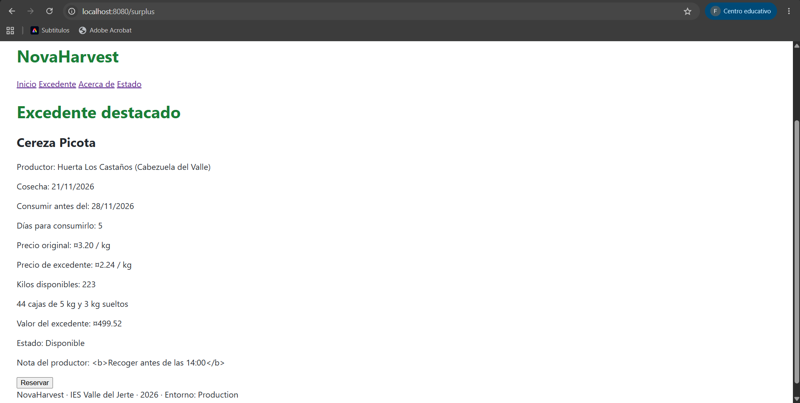

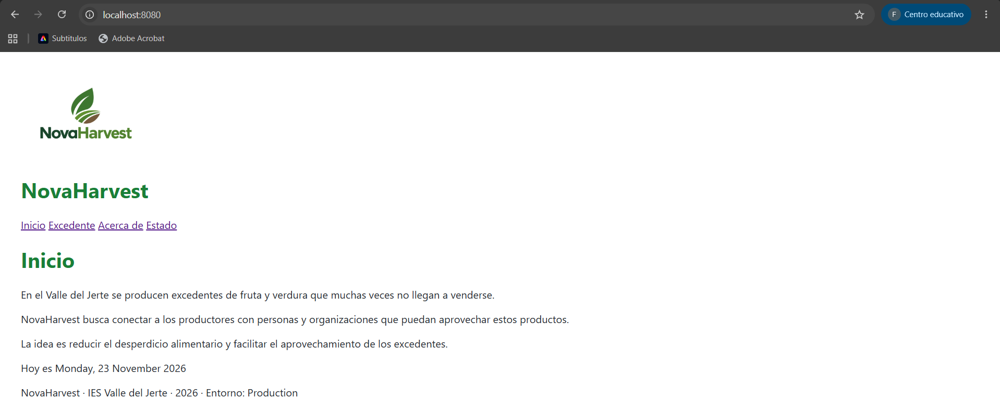

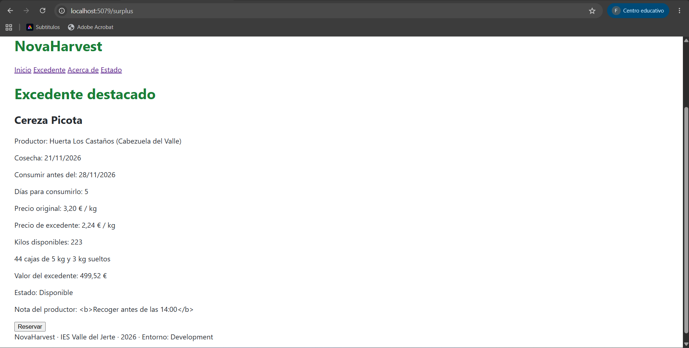

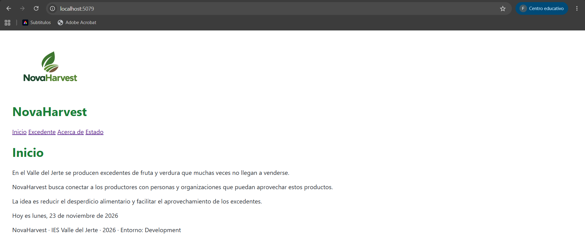

### 9. Ámbito

Primero, he sustituido temporalmente el contador por una variable local dentro de un bloque `@{ }` en `Status.cshtml`, inicializándola a `0` e incrementándola una vez. Al recargar la página varias veces, siempre mostraba `1`. Esto ocurre porque la variable se vuelve a inicializar cada vez que se solicita la página, por lo que no conserva el valor de la visita anterior.

Después, he vuelto a utilizar `SiteStats.Visits` y he abierto la página desde dos navegadores diferentes. He comprobado que el contador es compartido entre ambos, porque al entrar desde uno de ellos también aumenta el número de visitas de la misma aplicación. Esto ocurre porque `SiteStats.Visits` es una variable `static` que guarda su valor en la memoria del proceso del servidor.

También he probado a reiniciar el backend de Docker con `docker compose restart backend`. Al volver a entrar en `/status`, el contador aparecía en `1`. Esto ocurre porque el valor se guarda en la memoria del proceso y se pierde cuando se reinicia el backend.

Para que el layout muestre el título de la página, utilizo `ViewData["Title"]` en lugar de una variable local. En `Status.cshtml` le asigno el texto `"Estado del servidor"` y después el layout recoge ese valor mediante `@ViewData["Title"]`. Esto se debe a que las variables locales de la página no se comparten directamente con el layout.

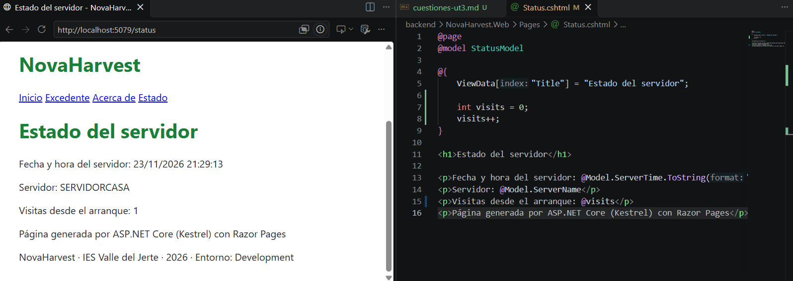

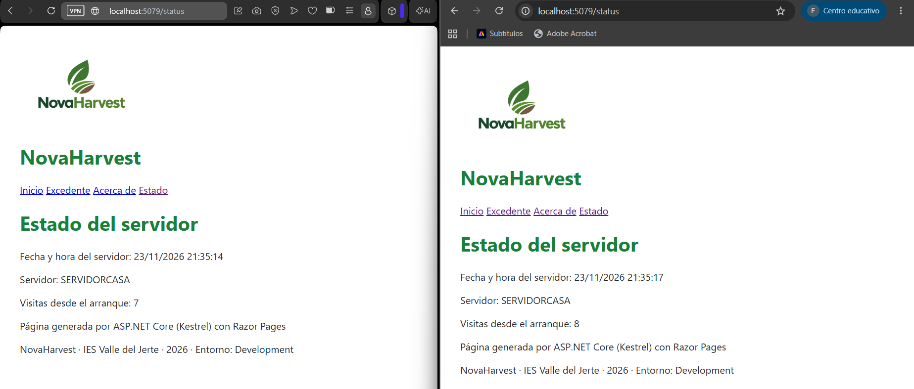

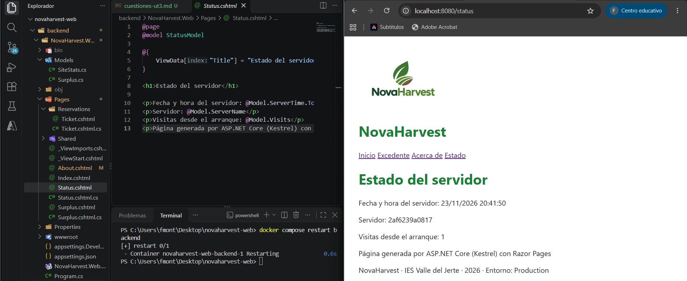

### 10. PageModel

En `SurplusModel`, que tengo en el archivo `Surplus.cshtml.cs`, he puesto los datos del excedente y los cálculos que necesito para mostrar la información, como los kilos restantes, el precio con descuento, el número de cajas completas o si el excedente es urgente. También inicializo los datos del producto dentro de `OnGet()`.

En cambio, en `Surplus.cshtml` tengo la parte que se muestra en el navegador, utilizando etiquetas HTML y expresiones Razor como `@Model.Surplus.Product` o `@Model.SurplusPrice` para mostrar los valores que calcula el modelo. También utilizo algunas condiciones para cambiar la apariencia de la página, por ejemplo, cuando el excedente es urgente o cuando no queda stock. De esta forma, separo los cálculos y los datos de la parte visual.

Un ejemplo de cálculo que tengo en `SurplusModel` es `RemainingKg = Surplus.AvailableKg - Surplus.ReservedKg`. Como hay 343 kg disponibles y 120 kg reservados, quedan 223 kg.

Si cargo `/surplus` tres veces, se crean **tres objetos `SurplusModel`**, uno por cada petición. Cada objeto se utiliza durante su petición y deja de utilizarse cuando termina. Por eso, los datos del modelo no se conservan automáticamente entre las distintas cargas de la página.

En cambio, `SiteStats` es una clase estática y su contador se mantiene en la memoria del proceso del servidor, por lo que es compartido entre las distintas peticiones. No se crea un contador nuevo cada vez que se carga una página y su valor se mantiene hasta que se reinicia el backend. En mi proyecto, el contador aumenta cada vez que se carga la página `/status`, porque en el código de esa página se suma una visita.